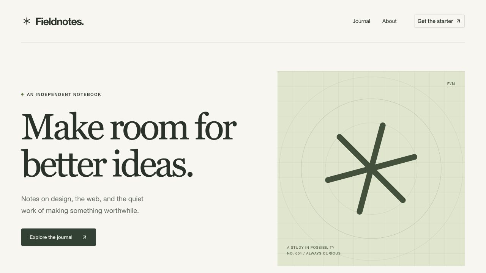

# Astro + Payload 4 starter

An Astro version of [Payload's official TanStack starter](https://github.com/payloadcms/payload/tree/v4.0.0-beta.3/templates/blank-tanstack), with a working publication built using [Bejamas UI](https://ui.bejamas.com).

Astro 7 renders the website. Payload 4 runs its official TanStack Start admin in a separate app. The site reads published content through Payload's typed REST SDK, so publishing updates the next page request without a rebuild. Payload 4 is in beta; all Payload packages are pinned to `4.0.0-beta.3`.



## Run locally

Install Node 24.15 or newer and Bun 1.3.14, then run:

```sh
bun install --frozen-lockfile
bun run setup
bun run seed
bun run dev
```

Open the site at <http://localhost:4321> and the admin at <http://localhost:3000/admin>. Create your first admin account in Payload. No account or shared password is included in the seed.

`setup` creates `.env` with a random signing secret. `seed` adds two pages, three posts, original sample artwork, and site settings. Rerunning either command keeps existing values and documents. To create a local editor during seeding, set both `SEED_ADMIN_EMAIL` and `SEED_ADMIN_PASSWORD` in `.env` before running the seed.

If a port is occupied, change `SITE_URL` or `CMS_URL` in `.env` and restart. Use the same hostname for both apps, such as `localhost`, so the editor's login cookie reaches preview.

## Edit the demo

- **Pages** contain Hero, Features, Rich text, FAQ, and Call to action blocks. The `home` slug renders at `/`; other pages render at `/<slug>`.
- **Posts** contain a cover image, excerpt, category, author, publication date, and Lexical body. Published posts appear in `/journal` with pagination.
- **Media** supports image uploads, required alt text, folders, and tags. Payload's new Sharp transformer creates a `960 × 720` WebP card variant.
- **Site settings** controls the name, navigation, description, and footer.
- **Draft preview** uses Payload's Preview action after you save. It requires your editor login. It shows the saved draft; refresh after another save. Unsaved live preview is not implemented.

Public requests never forward editor credentials to Payload. Public queries explicitly select published documents, including when a visitor is signed in. Preview responses use `no-store` and `noindex`.

## Change the UI

The components in `apps/web/src/ui` are copied from Bejamas UI and belong to this project. Edit them directly. The theme and layout styles live in `apps/web/src/styles/globals.css`.

Add another component from the web app:

```sh
cd apps/web
bunx bejamas@0.6.0 add dialog
```

`components.json` records the registry style and aliases. The site uses Astro components and the small `@data-slot/accordion` behavior script. It sends no React islands to visitors.

## Commands

| Command                            | Result                                                     |
| ---------------------------------- | ---------------------------------------------------------- |
| `bun run dev`                      | Start both development servers                             |
| `bun run generate`                 | Regenerate shared content types and the admin import map   |
| `bun run check`                    | Type check the CMS and Astro components                    |
| `bun run format:check`             | Check formatting                                           |
| `bun run build`                    | Build both apps without a running CMS                      |
| `bun run start`                    | Run both production builds                                 |
| `bun run test`                     | Test the running apps through HTTP                         |
| `bun run smoke`                    | Start production builds, run the HTTP tests, and stop them |
| `bun run migrate:create my-change` | Generate a database migration after a schema change        |
| `bun run migrate`                  | Apply database migrations                                  |

The tests need an editor. Set `SEED_ADMIN_EMAIL` and `SEED_ADMIN_PASSWORD`, then run `bun run seed`. Run `bun run build && bun run smoke` to test the production apps. The suite creates temporary content and removes it afterward. CI runs type checks, formatting, generated-file checks, a production build, fresh-database migrations, and these integration checks.

## Project layout

| Path                                | Owns                                                                    |
| ----------------------------------- | ----------------------------------------------------------------------- |
| `apps/cms/src/payload.config.ts`    | Collections, page blocks, access rules, image transformer, and settings |
| `apps/cms/src/app/_payload`         | Official Payload TanStack routes and server functions                   |
| `apps/cms/src/migrations`           | SQLite schema migrations                                                |
| `apps/cms/src/seed.ts`              | Repeatable sample content and artwork                                   |
| `apps/web/src/lib/cms.ts`           | Server-side typed SDK, queries, and media URLs                          |
| `apps/web/src/components`           | Astro section and article rendering                                     |
| `apps/web/src/ui`                   | Copied Bejamas UI components                                            |
| `packages/content/payload-types.ts` | Generated Payload types shared with Astro                               |
| `tests/integration.test.mjs`        | Access, drafts, publishing, media, SEO, and route checks                |

See [the architecture decision](docs/architecture.md) for the framework choice and the request flow.

## Deploy

Run the two Node services on a host with a persistent filesystem, or deploy them independently. The repo includes the initial database migration and no hosting-provider credentials.

1. Set a unique `PAYLOAD_SECRET`, public `CMS_URL`, and public `SITE_URL` in the deployment environment.
2. Set `DATABASE_URL` to a persistent SQLite path or a libSQL URL. Persist `apps/cms/media` too, or add a [Payload storage adapter](https://payloadcms.com/docs/beta/upload/storage-adapters). Local uploads are publicly readable, including images attached to drafts.
3. Run `bun install --frozen-lockfile` and `bun run build`.
4. On a new production database, run `NODE_ENV=production bun run migrate`. Keep development and production databases separate. Commit a new migration after each schema change.
5. Start the CMS with `bun run --cwd apps/cms start`, and the site with `HOST=0.0.0.0 PORT=4321 bun run --cwd apps/web start`. Set `NODE_ENV=production` on both services. The individual start commands use your environment; `bun run start` loads the root `.env` for a local production check.
6. For preview on `cms.example.com` and `www.example.com`, set `PAYLOAD_COOKIE_DOMAIN=.example.com` on the CMS and use HTTPS. Share cookies only among subdomains you control. The default host-only cookie works when both apps use one hostname.
7. Create the first admin before opening the CMS to the public. All admin users in this starter have full content and user-management access. Configure a real email adapter for password recovery; development email is logged to the console.

Astro renders on each request and returns `503` if Payload is unavailable. This starter has saved-draft preview, one language, and public image uploads. It does not include an Astro adapter for the Payload admin, unsaved live preview, or MCP integration.

## License

[MIT](LICENSE), Bejamas Group sp. z o. o. The copied Payload routes and Bejamas UI components retain their upstream licenses in `THIRD_PARTY_PAYLOAD_LICENSE` and `THIRD_PARTY_UI_LICENSE`.
